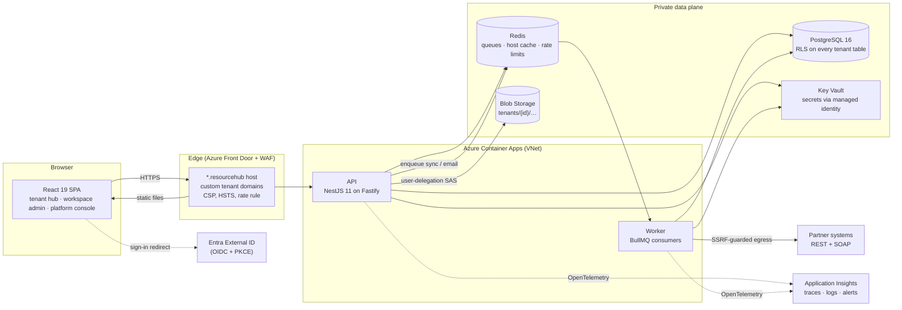
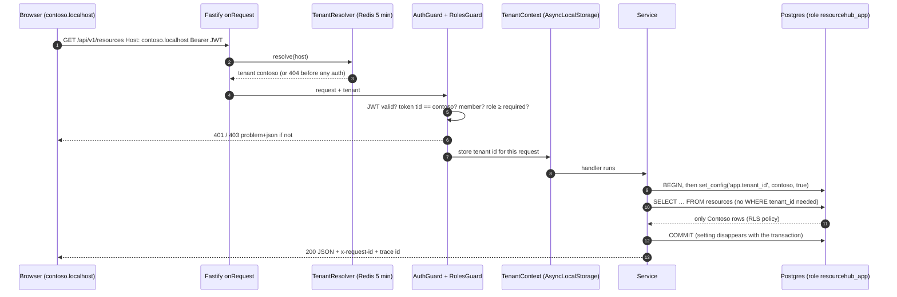
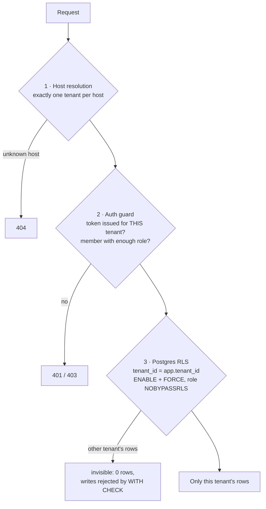
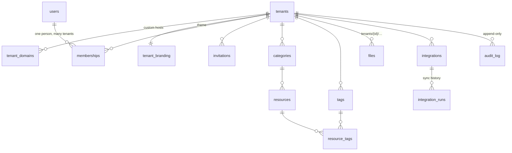
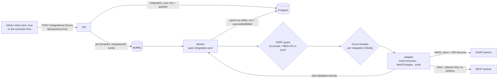
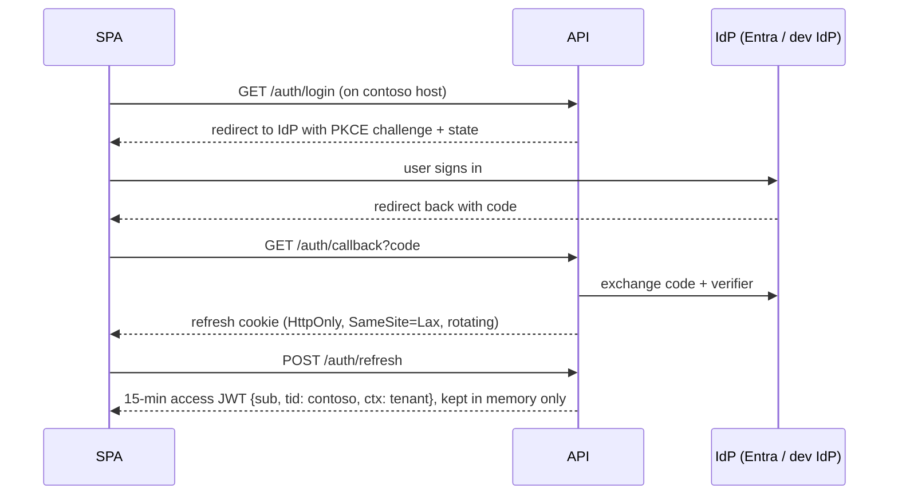
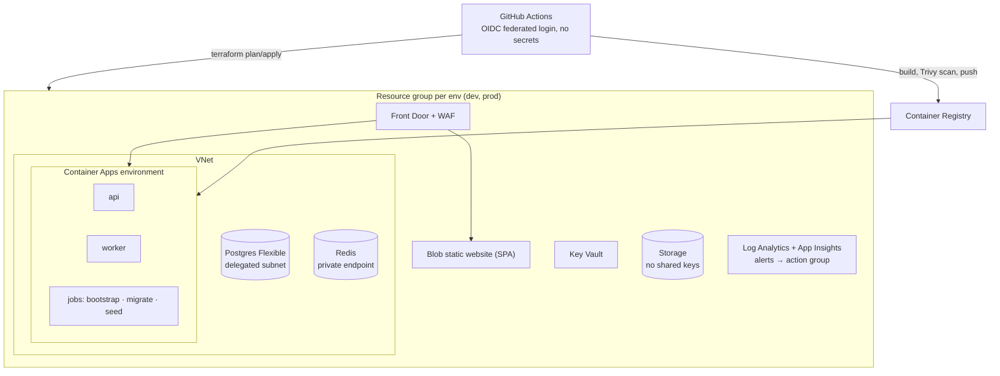

# Architecture

ResourceHub is one database shared by every tenant, guarded by three independent layers of
isolation. Behind it are a stateless API, a queue-driven worker, and a single SPA that becomes a
tenant hub, a workspace admin or a platform console depending on the hostname.

Diagrams are Mermaid and render on GitHub. Why each decision was made is in [`adr/`](adr).

## 1. System overview

| Piece            | Responsibility                                                                                                                 | Code                    |
| ---------------- | ------------------------------------------------------------------------------------------------------------------------------ | ----------------------- |
| **API**          | Resolves the tenant from the host, authenticates, authorises, and runs every query inside a tenant-pinned transaction          | `apps/api`              |
| **Worker**       | Integration syncs (REST/SOAP) and outgoing email, outside the request path. Each job carries its `tenantId` and runs under RLS | `apps/worker`           |
| **SPA**          | One build. The host decides the experience: `{tenant}.…` is the hub plus admin, `admin.…` is the platform console              | `apps/web`              |
| **db**           | Drizzle schema, SQL migrations that create RLS policies, the three Postgres roles, seed                                        | `packages/db`           |
| **contracts**    | Zod schemas shared by both sides. They produce request validation, OpenAPI 3.1 and the SPA's typed client                      | `packages/contracts`    |
| **integrations** | One adapter interface; REST and SOAP clients with retry, a circuit breaker and an SSRF guard                                   | `packages/integrations` |

## 2. Life of a request

Everything tenant-specific comes from the **Host header**. The URL never contains a tenant id, so
there is nothing for a user to tamper with.

| Step                                                           | Where                                                                                            |
| -------------------------------------------------------------- | ------------------------------------------------------------------------------------------------ |
| Host → tenant, unknown host → 404                              | `apps/api/src/modules/tenants/tenant-resolver.service.ts`, hook in `apps/api/src/app.factory.ts` |
| Token checks (`tid` must match host, `ctx` tenant vs platform) | `apps/api/src/common/auth.guard.ts`                                                              |
| Role hierarchy `viewer < editor < admin < owner`               | `apps/api/src/common/roles.ts`                                                                   |
| Tenant context in AsyncLocalStorage                            | `apps/api/src/common/tenant-context.interceptor.ts`                                              |
| `withTenantTx()` / `withPlatformTx()`                          | `apps/api/src/infra/db.service.ts` → `packages/db/src/database.ts`                               |
| Errors as RFC 9457 problem+json, with the trace id             | `apps/api/src/common/problem.ts`                                                                 |

## 3. Three layers of tenant isolation

Each layer would have to fail **on its own** before one tenant could see another's data.

**Database roles** (`packages/db/sql/00-roles.sql`):

| Role                   | Used by                                     | RLS                                                |
| ---------------------- | ------------------------------------------- | -------------------------------------------------- |
| `resourcehub_migrator` | Migrations only (CI / a Container Apps Job) | Owns the tables                                    |
| `resourcehub_app`      | API and worker                              | `NOBYPASSRLS`, owns nothing, so RLS always applies |
| `resourcehub_platform` | Platform console and cross-tenant jobs only | `BYPASSRLS`; every use writes an audit row         |

**Belt and braces:**

- Composite foreign keys `(tenant_id, id)`, so a row can't point at another tenant's row even by bug.
- Blob paths must start with `tenants/{id}/`. A DB CHECK enforces it and the SAS signer refuses other prefixes.
- Cache keys are tenant-namespaced (`apps/api/src/infra/tenant-cache.ts`).
- With no `app.tenant_id` set, the app role sees **zero rows**. It fails closed.

**Proof:**

- `apps/api/test/isolation/` calls every route with tenant B's real ids using tenant A's token.
  A coverage check fails CI when someone adds a route without adding it to the test.
- `pnpm db:check-rls` and the CI `rls-coverage` job fail if any table lacks RLS + FORCE + a policy.
- The k6 load test checks every response for the other tenant's data (see [`performance.md`](performance.md)).

## 4. Data model

`tenants` and `users` are global. Every other table has `tenant_id`, an index that leads with it,
and an RLS policy, all created in the same migration (`packages/db/drizzle/`). `audit_log` is
INSERT/SELECT only for the app role.

## 5. Integrations

SOAP and partner REST APIs stay at the edge. Domain code only ever sees typed records.

| Piece                                                | Where                                                            |
| ---------------------------------------------------- | ---------------------------------------------------------------- |
| Adapter interface, provider catalogue                | `packages/integrations/src/types.ts`, `catalog.ts`, `providers/` |
| SOAP client (committed WSDLs, no runtime WSDL fetch) | `packages/integrations/src/soap/client.ts`                       |
| REST client                                          | `packages/integrations/src/rest/http.ts`                         |
| Retry, circuit breaker, SSRF egress guard            | `packages/integrations/src/resilience/`                          |
| Job processing and run bookkeeping                   | `apps/worker/src/sync.ts`, `apps/worker/src/main.ts`             |

Secrets never live in `integrations.config`. `secret_ref` points at Key Vault (`kv:…`) in Azure,
or at an env var (`env:…`) locally.

## 6. Authentication

- A refresh token that is **reused** revokes the whole session family, writes an audit row, and fires an alert.
- Locally, `AUTH_PROVIDER=dev` swaps in a built-in OIDC provider with a "sign in as" page.
  Config refuses it in production.
- Platform admins sign in on the admin host and get a `ctx: platform` token. That token is useless on tenant hosts.
- Impersonation needs a written reason, shows a banner, and audits every action as "X acting as Y".

## 7. Azure deployment

- **On a PR:** lint, typecheck, unit, Testcontainers integration and isolation tests, RLS
  coverage, Playwright, CodeQL, and `pnpm audit`.
- **On merge to `main`:** images are built, scanned and pushed, then Terraform applies, migrations
  run as a job inside the VNet, and the apps deploy to `dev`.
- **On a release tag:** a manual approval gate, then the same images deploy to `prod`.
- Activation steps are in [`runbooks/azure-deploy.md`](runbooks/azure-deploy.md).

## 8. Observability

- `node --import ./dist/instrumentation.js` loads the Azure Monitor OpenTelemetry distro before
  the app. This happens only when `APPLICATIONINSIGHTS_CONNECTION_STRING` is set.
- Auto-instrumented: incoming HTTP, outgoing HTTP/SOAP, Postgres and Redis. Each request span is
  tagged with `tenant.id` and `tenant.slug`.
- Each worker job is one span, `integration.<type>`, tagged with tenant, integration, run, attempt
  and outcome. The partner HTTP calls and SQL calls inside it are its children.
- pino JSON logs carry `trace_id`/`span_id`, and credentials are redacted. Error responses return
  the trace id, so a user's error report leads straight to the trace.
- Alerts (`infra/terraform/modules/resourcehub/monitoring.tf`): API 5xx rate, API p95 latency,
  integration failures per tenant, refresh-token reuse, Postgres CPU, and Redis memory.

See [ADR 0007](adr/0007-observability-and-hardening.md).
